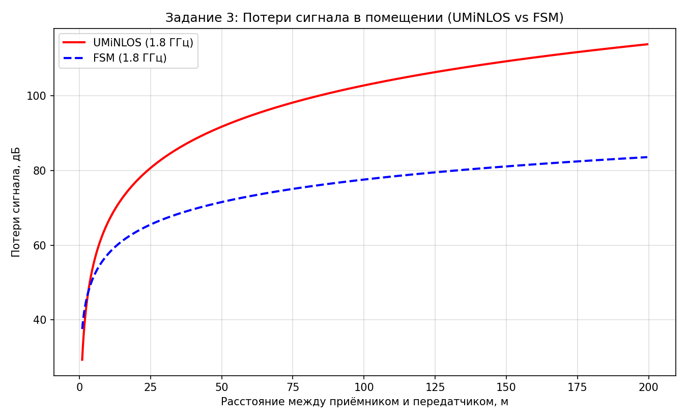
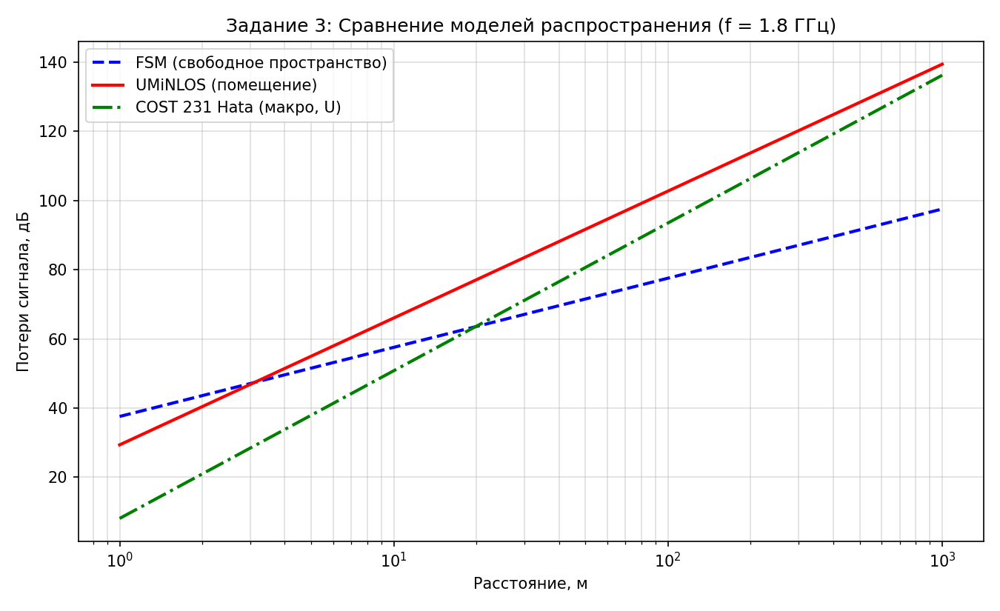
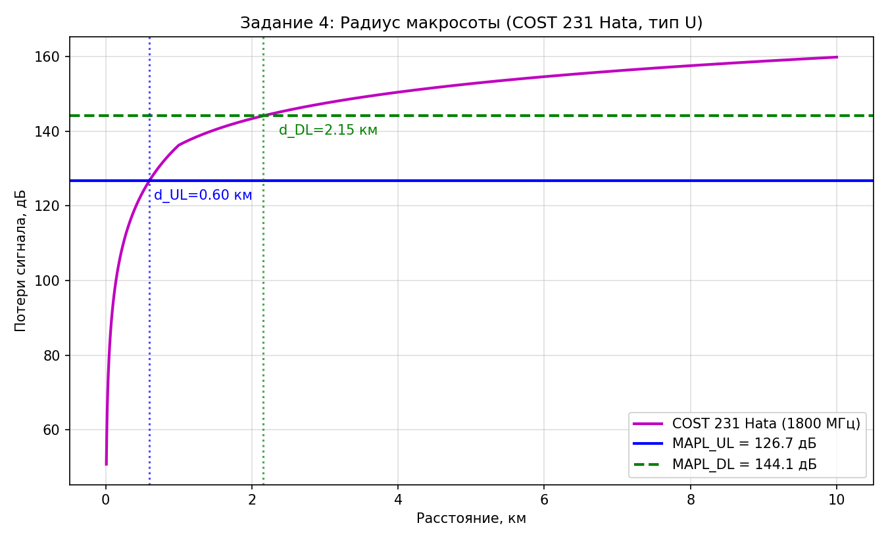
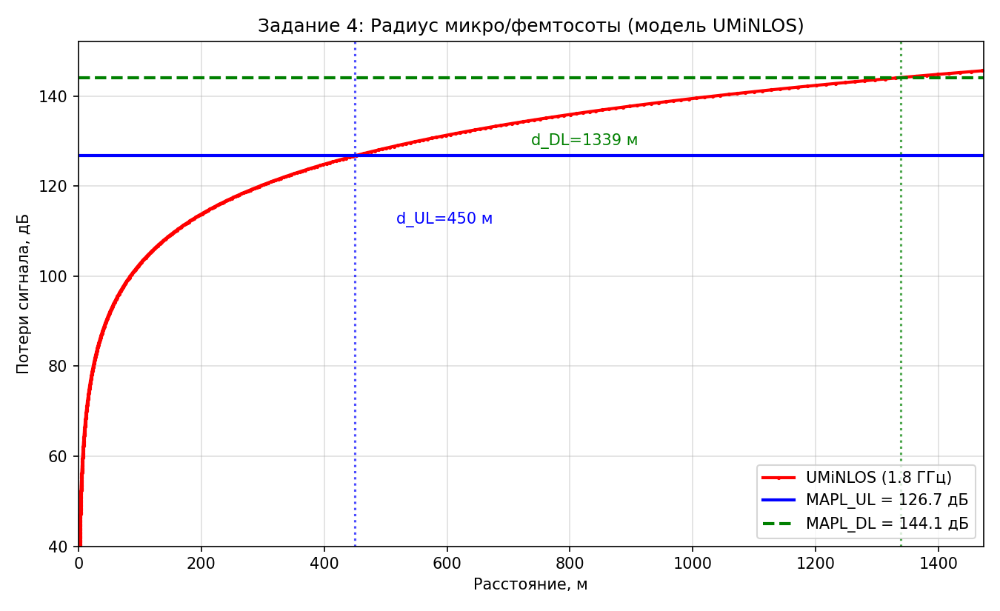

# Практическая работа №2. Салий Владислав Павлович, гр. ИКС-431

**Занятие №2. Проектирование радиопокрытия мобильных сетей. Модели распространения сигналов. Бюджеты каналов.**

*Учебное пособие: Дроздова В. Г. «Основы мобильных сетей LTE», СибГУТИ.*

## 1. Цель работы

Получить представление о проектировании покрытия сетей мобильной связи и научиться рассчитывать радиус действия (радиопокрытие) отдельных базовых станций (сот).

## 2. Исходные данные

| Параметр | Значение |
|---|---|
| Мощность передатчика БС (TxPowerBS) | 46 дБм |
| Мощность передатчика UE (TxPowerUE) | 24 дБм |
| Усиление антенны БС (AntGainBS) | 21 дБи |
| Число секторов на БС | 3 |
| Число антенн MIMO (MIMOGain) | 2 (3 дБ) |
| Запас на проникновение (PenetrationM) | 15 дБ |
| Запас на интерференцию (IM) | 1 дБ |
| Потери фидерного тракта (FeederLoss) | 2.9 дБ |
| Диапазон частот (f) | 1.8 ГГц (1800 МГц) |
| Полоса UL / DL | 10 / 20 МГц (FDD) |
| Коэфф. шума BS / UE | 2.4 / 6.0 дБ |
| Требуемое SINR DL / UL | 2 / 4 дБ |
| Модель макросот | COST 231 Hata (hBS=30 м, hms=1.5 м, тип U) |
| Модель микро/фемтосот | UMiNLOS |
| Площадь под макросоты | 100 кв.км |
| Площадь под микро/фемтосоты | 4 кв.км |

> **Допущения.** В исходных данных не заданы высоты антенн и тип местности для COST 231 Hata — приняты типовые: hBS = 30 м, hms = 1.5 м, местность U (город). FeederLoss для БС «с фидерами» = 2 + 0.4 + 0.5 = 2.9 дБ (по тексту методички).

## 3. Ход работы

### Задание 1. Бюджет восходящего канала (UL) → MAPL_UL

- Тепловой шум (BW_UL): -174 + 10·log10(10·10⁶) = -104.00 дБм
- Чувствительность RxSensBS = NF_BS + ThermalNoise + SINR_UL = 2.4 + (-104.00) + 4 = -97.60 дБм
- MAPL_UL = TxPowerUE − FeederLoss + AntGainBS + MIMOGain − IM − PenetrationM − RxSensBS
  = 24 − 2.9 + 21 + 3 − 1 − 15 − (-97.60) = 126.70 дБ

### Задание 2. Бюджет нисходящего канала (DL) → MAPL_DL

- Тепловой шум (BW_DL): -174 + 10·log10(20·10⁶) = -100.99 дБм
- Чувствительность RxSensUE = NF_UE + ThermalNoise + SINR_DL = 6.0 + (-100.99) + 2 = -92.99 дБм
- MAPL_DL = TxPowerBS − FeederLoss + AntGainBS + MIMOGain − IM − PenetrationM − RxSensUE
  = 46 − 2.9 + 21 + 3 − 1 − 15 − (-92.99) = 144.09 дБ

### Задание 3. Модели распространения и выбор модели

Параметры COST 231 Hata (f=1800 МГц → табл. 2.1): A=46.3, B=33.9, a(hms)=-0.001, Lclutter=0.0.
- **FSM** — свободное пространство (эталон, без учёта среды).
- **UMiNLOS** — городская микросота / помещение → применяем для микро/фемтосот.
- **COST 231 Hata** — макросоты → применяем для макросот.

### Задание 4. Радиусы сот, площадь и число БС

Радиус — пересечение MAPL_UL/MAPL_DL с кривой PL(d); берём меньший из d_UL и d_DL. Площадь сайта с 3 секторами: S = 1.95·R² (рис. 2.7).

| Сценарий | Модель | d_DL | d_UL | Радиус R | S сайта | Число БС |
|---|---|---|---|---|---|---|
| Макросоты (100 км²) | COST 231 Hata | 2.152 км | 0.598 км | **0.598 км** | 0.697 км² | 143.39 → **144** |
| Микро/фемтосоты (4 км²) | UMiNLOS | 1339 м | 450 м | **450 м** | 0.394 км² | 10.14 → **11** |

## 4. Ответы на контрольные вопросы

**1) Какие модели распространения сигналов используются для расчёта радиопокрытия сетей мобильной связи?**

Аналитическая модель распространения в свободном пространстве FSM/FSPM (формулы 2.1–2.2) — базовая, учитывает только частоту и расстояние. Эмпирические модели: UMiNLOS (городская микросота / помещение, формула 2.3), Okumura‑Hata и её модификация COST 231 Hata (макросоты, формулы 2.4–2.7), Walfish‑Ikegami (макросота в городской grid‑застройке, формулы 2.8–2.16), а также Knife‑Edge, Hata и др.

**2) Какие основные составляющие бюджета восходящего (UL) и нисходящего (DL) каналов в радиосетях?**

Мощность передатчика (TxPowerBS для DL, TxPowerUE для UL), потери в антенно‑фидерном тракте (FeederLoss), усиление антенны БС (AntGainBS), выигрыш MIMO (MIMOGain), максимально допустимые потери MAPL, запас на интерференцию (IM), запас на проникновение сквозь стены (PenetrationM) и чувствительность приёмника (RxSensUE для DL, RxSensBS для UL).

**3) Чем отличается чувствительность приёмника базовой станции BS и пользовательского терминала UE?**

Чувствительность считается по формуле 2.17: RxSens = NoiseFigure + ThermalNoise + RequiredSINR. Различаются коэффициент шума (у БС ниже — 2.4 дБ, у UE выше — 6.0 дБ), полоса приёма и требуемое SINR, которые зависят от направления. В UL сигнал принимает БС (RxSensBS = -97.60 дБм), в DL — терминал UE (RxSensUE = -92.99 дБм). Из‑за более высокого шума приёмник UE менее чувствителен.

**4) Что такое тепловой шум и как он определяется?**

Тепловой (джонсоновский) шум — собственный шум резистивных элементов приёмника при температуре T. Плотность шума на 1 Гц при 20 °C ≈ −174 дБм/Гц. Уровень: ThermalNoise = −174 + 10·log10(BW[Гц]) (формула 2.18). Чем шире полоса приёма, тем выше шум и хуже чувствительность.

**5) Что ограничивает радиус соты мобильных сетей в нисходящем и восходящем каналах?**

Радиус — это расстояние, на котором потери PL(d) достигают MAPL выбранной модели. В DL его определяют мощность передатчика БС (46 дБм) и чувствительность UE; в UL — малая мощность терминала (24 дБм) и чувствительность БС. Итоговый радиус соты берут по меньшему из d_UL и d_DL: в обоих сценариях ограничивает восходящий канал (маломощный терминал).

**6) Из чего состоят потери сигнала в антенно‑фидерном тракте базовой станции BS?**

Потери в фидере (≈ 2 дБ), потери в малошумящем усилителе МШУ (≈ 0.4 дБ) и потери в соединительном джампере до антенны (≈ 0.5 дБ). Если БС развёрнута без фидера (приёмо‑передатчик рядом с антенной), учитывают только потери джампера 0.5 дБ.

## 5. Вывод

Рассчитаны бюджеты каналов: MAPL_UL = 126.70 дБ, MAPL_DL = 144.09 дБ. Построены кривые потерь по моделям FSM, UMiNLOS и COST 231 Hata и выбраны соответствующие условиям модели. Для макросот радиус соты ограничен восходящим каналом и составляет 0.598 км, что требует ≈144 базовых станций на 100 км². Для микро/фемтосот радиус 450 м и ≈11 станций на 4 км². Во всех случаях покрытие определяет более «слабый» восходящий канал из‑за малой мощности терминала пользователя.

---
**Репозиторий с кодом:** https://git.csc.sibsutis.ru/iks432s08/distributed-arch.git

