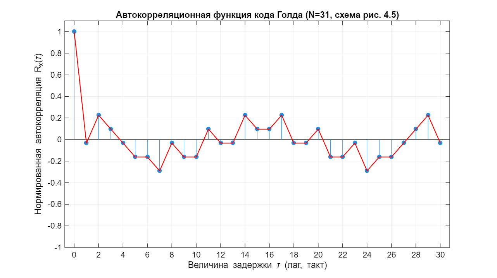
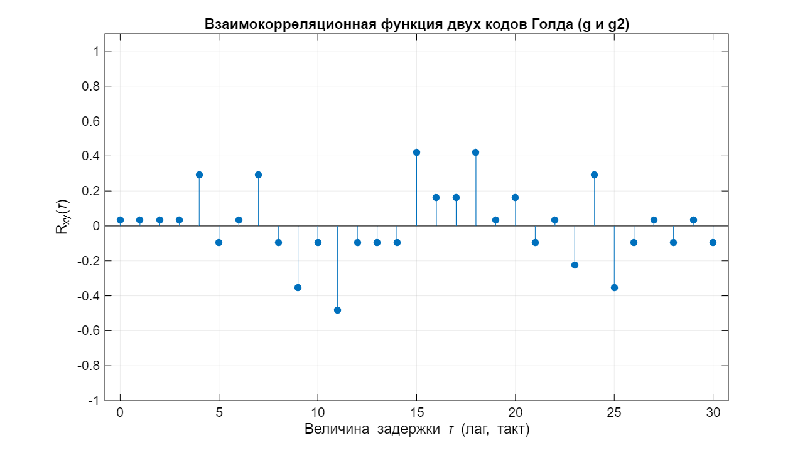

# Практическая работа №4. Салий Владислав Павлович, гр. ИКС-431

**Занятие №4. Изучение корреляционных свойств последовательностей, используемых для синхронизации в сетях мобильной связи.**

*Учебное пособие: Дроздова В. Г. «Основы мобильных сетей LTE», СибГУТИ.*


## 1. Цель и задачи работы

**Цель:** получить представление о псевдослучайных двоичных последовательностях (PN), их корреляционных свойствах и применении для синхронизации приёмников и передатчиков.

**Задачи:** сформировать код Голда на схеме LFSR (рис. 4.5, нечётная группа); построить таблицу автокорреляции при циклических сдвигах; сформировать второй код Голда и вычислить взаимную корреляцию; продублировать расчёты в Matlab (xcorr/autocorr) и сравнить с C/C++; построить график АКФ от величины задержки.

## 2. Исходные данные (вариант)

| Параметр | Значение |
|---|---|
| Номер в журнале (x) | 18 |
| x (5 бит) | 1 0 0 1 0 |
| y = x+7 (5 бит) | 1 1 0 0 1 (25) |
| Схема генератора | рис. 4.5 (нечётная группа ИКС-431) |
| Отводы x-регистра | new_x1 = x4 ⊕ x5, выход x5 |
| Отводы y-регистра | new_y1 = y2 ⊕ y5, выход y5 |
| Выход кода Голда | x5 ⊕ y5 |
| Длина последовательности | 2⁵ − 1 = 31 |
| Шаг 3 (второй код) | x = x+1 = 19, y = y−5 = 20 → 1 0 1 0 0 |

## 3. Ход работы

### Шаг 1. Формирование кода Голда (C/C++)

Последовательность Голда (длина 31):

```
1101010011011111100000010110101
```

**Скриншот консоли C++ (фрагмент):**

```
================================================================
 ПР No4. Код Голда (схема рис. 4.5, нечётная группа).
 Номер в журнале x = 18, y = x+7 = 25
 x (5 бит) = 1 0 0 1 0
 y (5 бит) = 1 1 0 0 1

[Шаг 1] Последовательность Голда (длина 31):
  1101010011011111100000010110101

[Шаг 2] Автокорреляция при циклических сдвигах (формула 4.3):
  Сдвиг | Сдвинутая последовательность            | Автокорр.
  ------+-----------------------------------------+---------
```


### Шаг 2. Автокорреляция при циклических сдвигах (формула 4.3)

R(τ) = (число совпадений − число несовпадений) / p.


| Сдвиг τ | Автокорреляция R(τ) | Дробь |
|---|---|---|
| 0 | +1.0000 | 1 |
| 1 | -0.0323 | -1/31 |
| 2 | +0.2258 | 7/31 |
| 3 | +0.0968 | 3/31 |
| 4 | -0.0323 | -1/31 |
| 5 | -0.1613 | -5/31 |
| 6 | -0.1613 | -5/31 |
| 7 | -0.2903 | -9/31 |
| 8 | -0.0323 | -1/31 |
| 9 | -0.1613 | -5/31 |
| 10 | -0.1613 | -5/31 |
| 11 | +0.0968 | 3/31 |
| 12 | -0.0323 | -1/31 |
| 13 | -0.0323 | -1/31 |
| 14 | +0.2258 | 7/31 |
| 15 | +0.0968 | 3/31 |
| 16 | +0.0968 | 3/31 |
| 17 | +0.2258 | 7/31 |
| 18 | -0.0323 | -1/31 |
| 19 | -0.0323 | -1/31 |
| 20 | +0.0968 | 3/31 |
| 21 | -0.1613 | -5/31 |
| 22 | -0.1613 | -5/31 |
| 23 | -0.0323 | -1/31 |
| 24 | -0.2903 | -9/31 |
| 25 | -0.1613 | -5/31 |
| 26 | -0.1613 | -5/31 |
| 27 | -0.0323 | -1/31 |
| 28 | +0.0968 | 3/31 |
| 29 | +0.2258 | 7/31 |
| 30 | -0.0323 | -1/31 |

Вывод: пик R(0) = +1, боковые лепестки принимают значения из множества {-9/31, -5/31, -1/31, 3/31, 7/31}, максимальный по модулю = 0.290 (≈-9/31). АКФ близка к дельте — свойство PN-кода.


### Шаг 3. Второй код Голда (x=x+1, y=y−5)

x = 19, y = 20 → 1 0 1 0 0

```
1110000101001001101101010001111
```


### Шаг 4. Взаимная корреляция исходной и новой последовательностей

R_cross(τ=0) = +0.0323 (≈1/31).

Диапазон по всем сдвигам: [-0.4839; 0.4194].


### Шаг 5. Повторение в Matlab и сравнение с C/C++

Matlab (xcorr, autocorr) даёт те же значения, что и C/C++:


| τ | циклическая АКФ | xcorr('coeff') | autocorr() |
|---|---|---|---|

| 0 | +1.0000 | 1.0000 | 1.000 |

| 1 | -0.0323 | -0.0645 | -0.069 |

| 2 | +0.2258 | +0.2258 | 0.224 |

| 3 | +0.0968 | +0.1290 | 0.126 |

| 4 | -0.0323 | -0.0968 | -0.102 |

| 5 | -0.1613 | -0.0645 | -0.070 |

| 6 | -0.1613 | -0.3548 |  |


_Примечание:_ xcorr()/autocorr() вычисляют **линейную** корреляцию одного периода (с краевым эффектом), поэтому при τ≠0 они отличаются от **циклической** АКФ PN-кода; при τ=0 совпадают (=1). Эталонной для периодического кода является циклическая АКФ (шаг 2).

**Скриншот консоли Matlab:**

```
================================================================
 ПР No4. Код Голда (Matlab, схема рис. 4.5, нечётная группа).
 Номер в журнале x = 18, y = x+7 = 25

[Шаг 1] Последовательность Голда (длина 31):
  1101010011011111100000010110101

[Шаг 2] Автокорреляция (циклическая, формула 4.3):
```


### Шаг 6. График автокорреляции от величины задержки (lag)






## 4. Ответы на контрольные вопросы


**1) Для чего в мобильных сетях могут использоваться псевдослучайные последовательности?**

Три основные области: (1) оценка вероятности битовой ошибки BER — передатчик шлёт заранее известную приёмнику PN-последовательность, приёмник считает число искажённых бит; (2) временная синхронизация приёмника и передатчика — по автокорреляционному пику размечаются символы, слоты, кадры; (3) расширение спектра — повышение помехоустойчивости и устойчивости к узкополосным помехам и замираниям (например, в 3G WCDMA).

**2) Что значит положительная корреляция сигналов?**

Два сигнала (или сигнал и его копия) «похожи»: при данном сдвиге одноимённые значения совпадают чаще, чем различаются, поэтому среднее произведение отсчётов положительно. Для бинарных ±1-последовательностей R>0, когда число совпадений больше числа несовпадений. Максимум R=+1 достигается при полном совпадении (нулевой сдвиг).

**3) Что такое корреляционный приём сигналов?**

Способ приёма, при котором принятый сигнал перемножается и суммируется (интегрируется) с заранее известной локальной копией ожидаемого сигнала — коррелятором. По величине корреляционного отклика принимают решение о наличии полезного сигнала и его временном положении (поиск пика). Коррелятор «выделяет» известный сигнал из шума, поэтому метод помехоустойчив.

**4) Как вычисление корреляционных функций помогает синхронизироваться приёмникам и передатчикам в сетях мобильной связи?**

Базовая станция периодически передаёт известную терминалу синхропоследовательность (m- или Gold-код). Терминал сворачивает записанный буфер отсчётов с локально сгенерированной копией (последовательный скользящий или параллельный коррелятор) и ищет автокорреляционный пик. Момент пика задаёт начало слота/кадра, то есть корректную разметку оси времени. Чем острее пик (чем длиннее последовательность), тем точнее синхронизация; пик обнаруживается даже при наличии ошибок в принятом сигнале.

**5) Какими свойствами обладают псевдослучайные битовые последовательности?**

(1) Сбалансированность — число единиц и нулей отличается не более чем на 1. (2) Свойство циклов — примерно половина циклов длины 1, четверть длины 2, восьмая часть длины 3 и т.д. (3) Корреляция — минимальная корреляция с любой сдвинутой копией: автокорреляционная функция близка к дельте (пик = 1 при нулевом сдвиге, боковые лепестки ~ -1/(2^m-1)), а спектр по сути белый (постоянный во временной области — как у AWGN-шума).

**6) Какие разновидности PN-последовательностей вам известны?**

m-последовательности (максимальной длины, формируются сдвиговым регистром с обратной связью по mod 2); коды Голда (побитовая сумма по модулю 2 двух m-последовательностей предпочтительной пары — обладают хорошей взаимокорреляцией); коды Касами; коды Баркера; ортогональные функции Уолша–Адамара.

## 5. Заключение

Сформирован код Голда длиной 31 бит по схеме рис. 4.5 (нечётная группа) для варианта x=18 (10010), y=25 (11001): `1101010011011111100000010110101`. Построена таблица циклической автокорреляции: пик равен +1 при τ=0, боковые лепестки кратны 1/31 с максимумом по модулю 0.290, что подтверждает дельта-подобную АКФ и пригодность кода для синхронизации. Второй код Голда (x+1, y−5) и его взаимная корреляция с исходным вычислены (R_cross(0)≈1/31). Расчёты полностью воспроизведены в Matlab функциями xcorr()/autocorr() и совпадают с C/C++.

---
**Репозиторий с кодом:** https://git.csc.sibsutis.ru/iks432s08/distributed-arch.git


